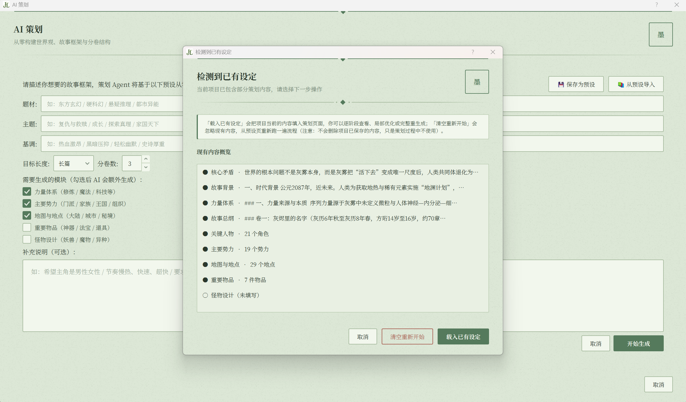
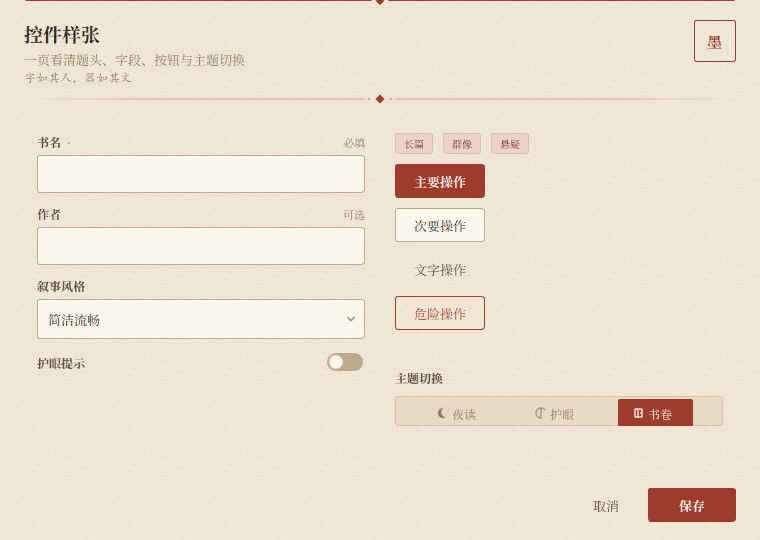
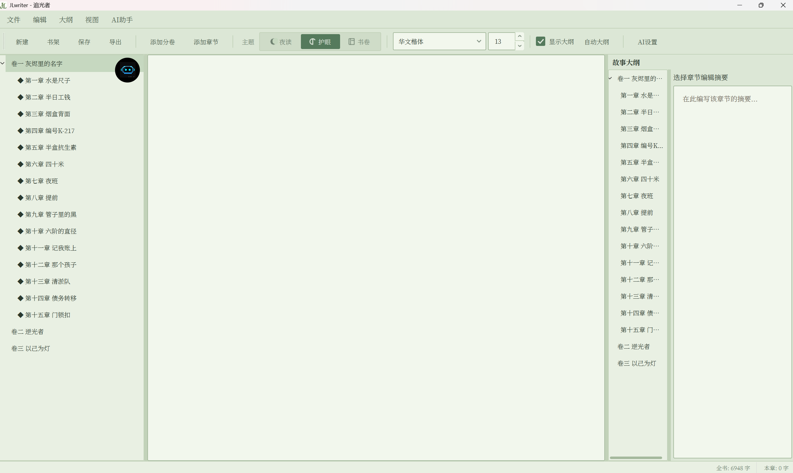
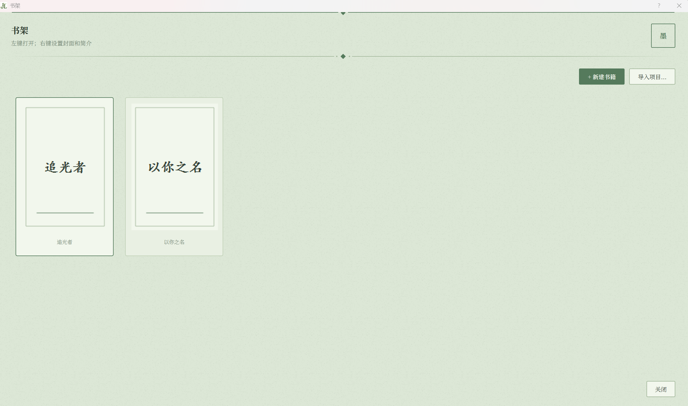
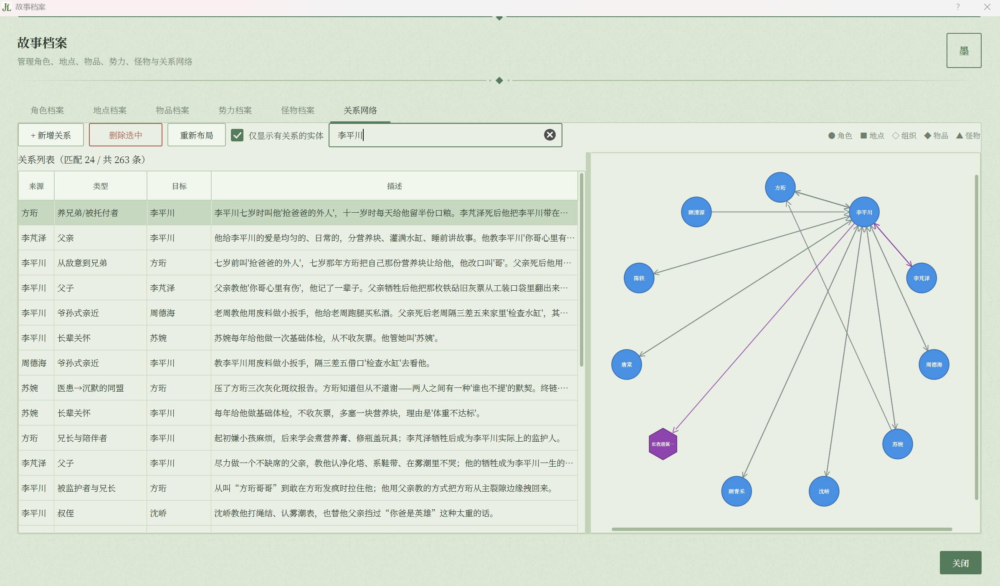
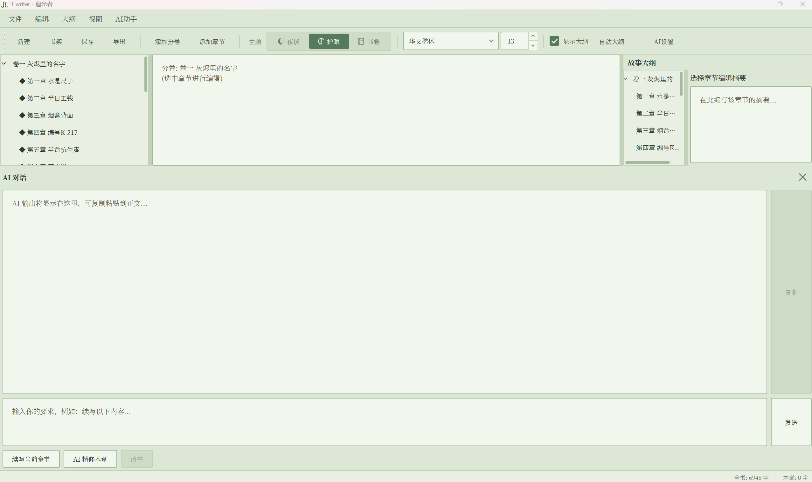
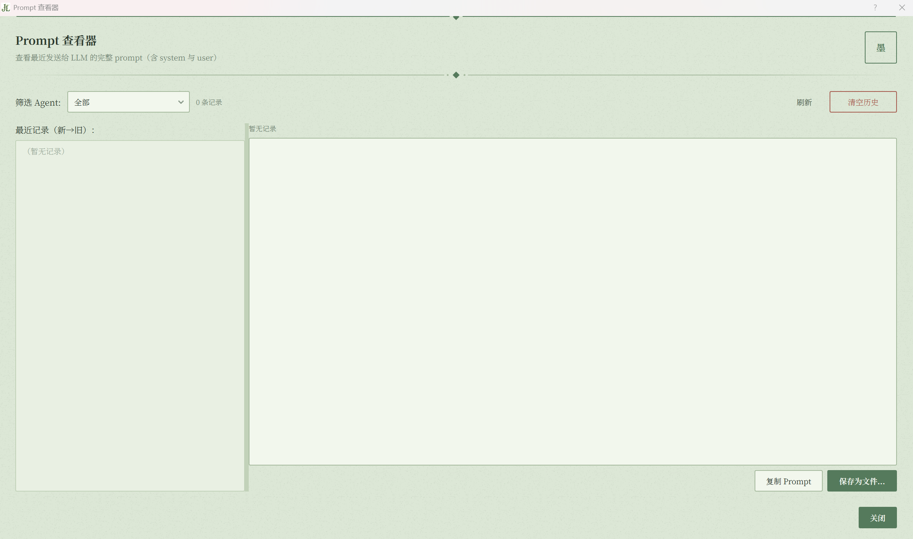

# JLwriter

<p align="center">
  
</p>

<p align="center">
  <a href="LICENSE"></a>
  <a href="https://www.python.org/downloads/"></a>
  <a href="https://pypi.org/project/jlwriter/"></a>
  
</p>

<p align="center">
  An AI long-form novel writing assistant with built-in GraphRAG and multi-agent collaboration
</p>

JLwriter is a desktop writing tool built for authors of long-form web novels. It connects "worldbuilding → volumes and arcs → chapter outlines → draft writing → refinement" into a complete workflow, and uses multi-agent collaboration with layered context injection to solve the two toughest problems in long-form novel creation: **setting consistency** and **context bloat**.

---

## Table of Contents

- [Core Features](#-core-features)
- [Screenshots](#-screenshots)
- [Quick Start](#-quick-start)
- [Usage Guide](#-usage-guide)
- [Configuration](#️-configuration)
- [Advanced](#-advanced)
- [Project Structure](#-project-structure)
- [FAQ](#-faq)
- [Development](#️-development)
- [License](#-license)
- [Acknowledgements](#-acknowledgements)

---

## ✨ Core Features

### 📚 Structured Long-Form Management

- **Bookshelf system**: Manage all works in one place, with covers, synopses, and sorting by most recently edited
- **Three-layer structure**: Volume → Arc → Chapter, matching how web novels are actually written
- **Complete archives**: Characters, locations, items, factions, and monsters, each with independent records
- **Relationship network**: Visualize multiple types of relationships among characters / locations / organizations / items / monsters

<p align="center">
  
  <br>
  <em>Story archives: characters / locations / items / factions / monsters / relationship network in one place</em>
</p>

### 🤖 Multi-Agent Collaboration

| Agent | Responsibility | Recommended Model |
| --- | --- | --- |
| **Planner Agent** | Builds worldbuilding, story arcs, chapter plans, and detailed outlines from scratch | Strongest available model |
| **Writer Agent** | Continues the main text based on detailed outlines | Long context + strong creative ability |
| **Editor Agent** | Refines text, removes AI flavor, improves prose | Good prose, fast response |
| **Reviewer Agent** | Consistency checks, plan review, corrections | High-frequency calls, choose cheap and fast |
| **Outline Agent** | Extracts structured outlines from chapters | Stable JSON output |
| **Extractor Agent** | Extracts archives from main text | Stable structured output |

Each Agent can be independently configured with its own provider, model, and System Prompt without interfering with others.

### 🧠 Layered Context (L0-L4)

For long novels with 20,000+ words of worldbuilding, JLwriter uses layered injection to avoid "settings being diluted":

| Layer | Content | Can Be Disabled |
| --- | --- | --- |
| **L0** | Current story state snapshot (character locations, health, emotions, known secrets) | ✅ Optional |
| **L1** | World hard rules (core conflict, background, power system, faction overview) | ✅ Optional (master outline can be disabled separately) |
| **L2** | Complete archives of entities relevant to this chapter (loaded precisely based on detailed outline) | — |
| **L3** | Plot trajectory (preceding outlines + current chapter plan + subsequent boundaries) | — |
| **L4** | Main text context (existing text of this chapter / full text of previous chapter) | — |

### 🕸️ Preliminary GraphRAG

- Automatic maintenance of chapter-entity indexes
- During continuation, relevant entities are filtered through graph traversal, injecting only necessary archives
- Relationship edges carry types and temporal order, preventing setting breakdowns such as "dead characters coming back to life" or "relationships being established too early"

### 🎬 AI Planning (Gacha-Style Generation)

Nine-stage progressive generation, with each step supporting single-stage retry or guidance-based optimization:

```
Core Conflict → Story Background → Power System → Master Outline → Key Characters
→ Major Factions → Map Locations → Important Items → Monster Design
```

After each stage is generated, it automatically enters a **validation pipeline** (consistency check → automatic correction → key fact extraction), ensuring subsequent stages do not deviate from prior settings.

<p align="center">
  
  <br>
  <em>AI Planning: nine independent stage pages, each supporting retry or optimization</em>
</p>

### 🎨 Other Practical Features

- **Detailed outline expansion**: Generate scene beats and required entity lists for each chapter
- **Knowledge base reference**: Mount AI-flavor removal templates and prose templates under `knowledge/` during refinement
- **Preset system**: One-click application of genre / theme / tone combinations, with support for saving custom presets
- **Export**: TXT / Markdown / PDF / long image (single chapter)
- **History**: Automatic snapshots on every save, with restore support
- **Prompt viewer**: View the complete prompts recently sent to the LLM for debugging and optimization
- **Multi-provider**: DeepSeek / OpenAI / Qwen / Gemini / GLM / Claude

### 🖋 Literary-Style UI with Three Themes

- **Night Reading / Eye Care / Book Scroll**: Switch via toolbar or "View → Theme"; old themes migrate automatically and settings persist
- **All dialogs integrated**: 24 dialogs unified with paper texture, Song-style headings, seals, and button hierarchy; `QMessageBox` also follows the theme
- **Small-screen friendly**: Designed against 2560×1600 with adaptive density; dialogs shrink automatically and body text scrolls; "View → UI Scale" offers 80%–110%
- **Portable widgets**: `src/jlwriter/ui/literary/` depends only on PyQt5; headings, fields, buttons, toggles, and theme switchers are all reusable
- **Real widget previews**: [Screenshots of the three themes](docs/ui-preview/index.html)



---

## 📸 Screenshots

<table>
  <tr>
    <td align="center" width="50%">
      
      <br>
      <sub>Main window: volume / chapter tree + editor + AI chat</sub>
    </td>
    <td align="center" width="50%">
      
      <br>
      <sub>Bookshelf: cover-card browsing, right-click to edit info</sub>
    </td>
  </tr>
  <tr>
    <td align="center" width="50%">
      
      <br>
      <sub>Chapter planning: volume → arc → chapter three-layer breakdown</sub>
    </td>
    <td align="center" width="50%">
      
      <br>
      <sub>Relationship network: multi-type nodes + directed edges</sub>
    </td>
  </tr>
</table>

<p align="center">
  
  <br>
  <em>Continuation workflow: streaming output → refinement → apply</em>
</p>

---

## 🚀 Quick Start

### Requirements

- Python ≥ 3.10
- Windows / macOS / Linux
- At least one LLM provider API Key (DeepSeek or GLM recommended for cost-effectiveness)

### Installation

```bash
pip install jlwriter
```

Or use `pipx` for isolated installation (recommended to avoid polluting the global environment):

```bash
pipx install jlwriter
```

### Run

```bash
jlwriter
```

Or run as a module:

```bash
python -m jlwriter.main
```

### First-Time Configuration

1. After launch, open `AI Assistant → AI Settings`
2. On the **API Keys** tab, fill in at least one provider's Key
   - [DeepSeek](https://platform.deepseek.com/)
   - [GLM](https://open.bigmodel.cn/)
   - [Qwen](https://dashscope.aliyuncs.com/)
   - [OpenAI](https://platform.openai.com/)
3. On the **Agent Configuration** tab, select a provider and model for each Agent
4. Click "Test This Agent Connection" to verify, then save

On first launch, a user agreement pops up explaining which texts will be sent to AI service providers.

---

## 🎯 Usage Guide

### Starting a Novel from Scratch

1. **Create a new book**: `File → New`, fill in title, author, synopsis, and cover
2. **AI Planning**: `AI Assistant → AI Planning`
   - Fill in genre, theme, tone, length, and number of volumes
   - Check the modules to generate (power system / factions / locations / items / monsters)
   - Click "Start Generation" and wait for the nine stages to complete
   - Review stage by stage; click "Regenerate This Stage" for unsatisfactory ones
   - When all are complete, click "Accept and Start Creating"
3. **Refine story archives**: `AI Assistant → View Story Archives`, manually supplement or fine-tune characters, locations, factions, relationships, etc. — essentially an entity state machine design
4. **Chapter planning**: `AI Assistant → Chapter Planning`
   - For each volume, click "Break This Volume into Arcs"
   - For each arc, click "Generate Next Batch of Chapters for This Arc" (8 chapters per batch)
   - Select a chapter and click "Expand Detailed Outline for This Chapter" to generate scene beats
5. **Start writing**: Open the AI chat window and click "Continue Current Chapter"
6. **Refinement**: After writing a section, click "AI Refine This Chapter", optionally mounting knowledge base references

### When You Already Have Existing Settings

When opening `AI Assistant → AI Planning`, if existing content is detected, you will be asked to choose:

- **Load Existing Settings**: Enter the workspace and review/optimize stage by stage
- **Clear and Start Over**: Ignore existing content and go through the process again

### Recommended Writing Workflow

```
Planning (build the world) → Archives (refine details) → Arc breakdown → Chapter planning → Detailed outline expansion
→ Main text continuation → Plan deviation check → Refinement → Save → World state snapshot
```

---

## ⚙️ Configuration

### User Data Directory

All work data is stored in the operating system's standard user data directory, independent of installation location:

| System | Path |
| --- | --- |
| Windows | `%APPDATA%\jlwriter\` |
| macOS | `~/Library/Application Support/jlwriter/` |
| Linux | `~/.local/share/jlwriter/` |

Can be overridden via environment variable:

```bash
JLWRITER_DATA_DIR=D:\my_jlwriter_data jlwriter
```

### Directory Structure

```
jlwriter/
├── book/                    # All books
│   └── My Novel/
│       ├── project.json     # Project data
│       ├── project.json.history.json
│       ├── meta.json        # Metadata (title, synopsis, cover)
│       └── cover.png
├── knowledge/               # Knowledge base (user-customizable)
│   ├── ai_style.md          # AI-flavor removal template
│   ├── xuanhuan.md
│   └── urban.md
└── presetting.json          # User-defined presets (optional)
```

### Knowledge Base Format

`knowledge/*.md` uses a simple section format, with one example per line under each section:

```markdown
# Xuanhuan Writing Reference

## Character Description
- The young man wore white robes, his brows sharp as if carved by knives, yet there was no warmth in his eyes.
- The old man hunched over, his skin dry as tree bark, yet he had the eyes of a child.

## Dialogue Description
- "You lost." He lowered his sword, his tone as calm as if stating the weather.

## Environment Description
- Above the mountain peak, clouds surged and rolled, occasionally revealing a few dark peaks.
```

`ai_style.md` is the AI-flavor removal template and is read in full; other md files are prose references, and several entries are randomly sampled from each section during refinement.

### Preset Format

`presetting.json`:

```json
{
  "version": 1,
  "presets": [
    {
      "id": "xianxia_classic",
      "icon": "🗡️",
      "name": "Classical Xianxia",
      "description": "Eastern fantasy, cultivating immortality",
      "genre": "Eastern Fantasy",
      "theme": "Seeking the Dao and guardianship",
      "tone": "Passionate and stirring",
      "target_length": "Long-form",
      "volume_count": 5,
      "need_power_system": true,
      "need_organizations": true,
      "need_locations": true,
      "need_items": true,
      "need_monsters": false,
      "user_notes": "Hope to have a complete sect system..."
    }
  ]
}
```

---

## 🔧 Advanced

### Per-Provider API Keys

All Agents share the same key table: one provider only needs to be filled in once. If different Agents use different providers, the corresponding key is automatically used when switching Agents.

### Story Master Outline in L1

In `AI Settings → Global Settings`, you can independently control "whether L1 includes the story master outline". When continuing a single chapter, L3 already covers preceding chapters and subsequent boundaries, so the story master outline is usually redundant; disabling it by default saves about 30%-50% of context.

### L0 World State

`AI Assistant → Generate Current Chapter World State` can generate a state snapshot for each chapter (character locations, health, emotions, known secrets, unresolved plot threads). When L0 is enabled, the previous chapter's state is automatically injected during continuation.

### Golden Three Chapters

At the top of `AI Settings → Agent Configuration`, you can enable "Golden Three Chapters Design". When enabled, story master outline generation, first-volume arc breakdown, first 3 chapter planning, and first 3 chapter detailed outlines all follow the principle of "Chapter 1 hooks the reader, Chapter 2 deepens the conflict, Chapter 3 delivers the first small climax".

### Prompt Viewer
<p align="center">
  
  <br>
  <em>Prompt viewer</em>
</p>
`AI Assistant → View Recent Prompts` (or right-click the floating button) lets you view the complete prompts sent to the LLM in the last 50 calls (including system and user; the cache is cleared after the software closes). Use it to:

- Debug "why didn't the AI write as I asked"
- Optimize prompt structure
- Copy / export prompts for comparative experiments

---

## 📁 Project Structure

```
JLwriter/
├── src/jlwriter/
│   ├── main.py                  # Entry point (def main())
│   ├── main_window.py           # Main window
│   ├── paths.py                 # Path management (user data / in-package resources)
│   ├── book_manager.py          # Book folder management
│   ├── models.py                # Data models
│   ├── ai_config.py             # AI configuration
│   ├── ai_assistant.py          # LLM request thread (streaming)
│   ├── agents.py                # Agent definitions
│   ├── planner_agent.py         # Planning, arc breakdown, chapter generation prompts
│   ├── reviewer_agent.py        # Review, correction prompts
│   ├── detailed_outliner.py     # Detailed outline expansion
│   ├── character_extractor.py   # Archive extraction
│   ├── character_index.py       # Chapter-entity index and filtering
│   ├── context_builder.py       # L0-L4 layered context assembly
│   ├── graph_builder.py         # NetworkX graph construction
│   ├── graph_query.py           # Subgraph queries
│   ├── world_state_builder.py   # L0 world state generation
│   ├── knowledge_manager.py     # Knowledge base reading
│   ├── preset_loader.py         # Preset loading
│   ├── exporter.py              # Export (TXT / MD / PDF / image)
│   ├── prompt_history.py        # Prompt history
│   ├── ui/                      # Design system
│   ├── knowledge/               # Built-in knowledge base examples
│   ├── ico/                     # Icons
│   └── presetting.json          # Built-in presets
├── pyproject.toml
├── README.md
└── LICENSE
```

---

## ❓ FAQ

### Q: `ModuleNotFoundError: No module named 'xxx'` on startup

Check whether it was installed via `pip install` rather than running `python main.py` directly. This project uses a standard package structure and does not support running scripts directly. To run from source, use `python -m jlwriter.main`.

### Q: AI responses are truncated

Increase the corresponding Agent's `max_tokens` in AI Settings. If generating an entire arc at once during chapter planning exceeds the model's output limit, switch to batch generation.

### Q: Setting contradictions often appear during continuation

Check:

1. Whether L1 is enabled in "AI Settings → Global Settings"
2. Whether detailed outlines have been expanded for the relevant chapters (detailed outlines load entity archives precisely)
3. Whether L0 world state is enabled (especially for chapters involving character state changes)

### Q: How to delete a book

Right-click the book in the bookshelf → Delete Book, which removes the entire folder. Backing up `book/<book name>/` first is recommended.

### Q: I want to use a local model (Ollama / vLLM)

Select "OpenAI" in AI Settings, change base_url to the local service address (e.g., `http://localhost:11434/v1`), and fill in the local model name. Any OpenAI-compatible service can be connected this way.

### Q: API call costs are too high

- Use cheap and fast models for high-frequency Agents (review / extraction / outline)
- Enable L0 and full L1 only for key chapters (volume openings, volume endings, turning-point chapters)
- Disable "Include story master outline in L1"
- Choose not to mount the knowledge base during refinement

---

## 🖼 Qwen-Image Generation Plugin (Optional)

The repository root includes an independent Python plugin `qwen_image/` that calls **Qwen-Image-3.0** to generate image assets for frontend development (hero visuals, OG share cards, empty-state illustrations, etc.), automatically downloads them to disk with metadata, and makes them directly referenceable from `public/`. It does not participate in the main program's runtime and can also be copied separately to other projects:

```bash
python -m qwen_image presets
python -m qwen_image generate "Login page background, soft blue-purple gradient" --preset hero --style minimal
python -m qwen_image batch qwen_image/examples/assets.example.json --jobs 3
```

The API Key defaults to `DASHSCOPE_API_KEY`; when on the same machine as the desktop app, you can add `--use-jlwriter-key` to reuse the saved Qwen Key and workspace domain. See [qwen_image/README.md](qwen_image/README.md) for details.

---

## 🛠 Development

### Local Development

```bash
git clone https://gitee.com/libin2jiang/jlwriter.git
cd jlwriter
python -m venv .venv
source .venv/bin/activate        # Windows: .venv\Scripts\activate
pip install -e ".[dev]"
```

### Run

```bash
python -m jlwriter.main
```

Or after packaging:

```bash
python -m build
pip install dist/*.whl
jlwriter
```

### Contributing

Issues and PRs are welcome. Before submitting a PR, please:

1. Confirm the code runs on at least one of Windows / macOS / Linux
2. Update the README when adding new features
3. Follow [Conventional Commits](https://www.conventionalcommits.org/) for commit messages

---

## 📄 License

This project is open-sourced under the [MIT License](LICENSE).

---

## 🙏 Acknowledgements

- [PyQt5](https://riverbankcomputing.com/software/pyqt/): Desktop UI framework
- [OpenAI Python SDK](https://github.com/openai/openai-python): Unified multi-provider LLM client
- [NetworkX](https://networkx.org/): Graph structure processing
- [json-repair](https://github.com/mangiucugr/JSON_Repair): JSON repair for LLM output
- All author friends who provided feedback in Issues and discussion areas

---

<p align="center">
  If this project helps you, feel free to give it a ⭐ Star
</p>